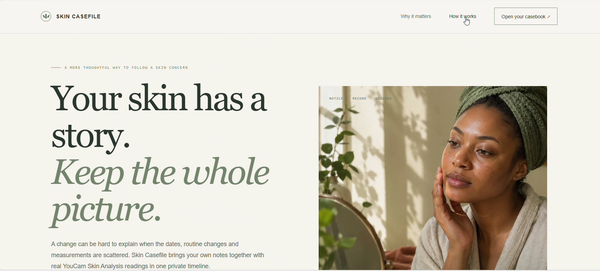
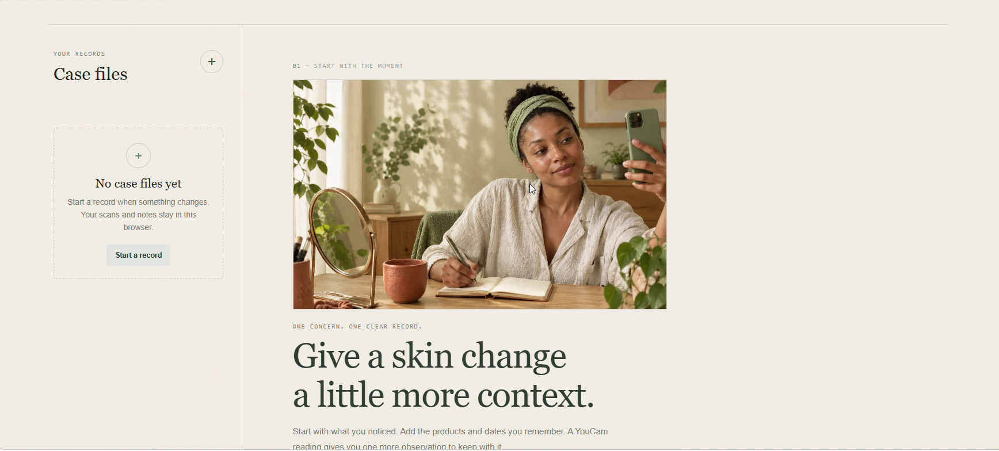
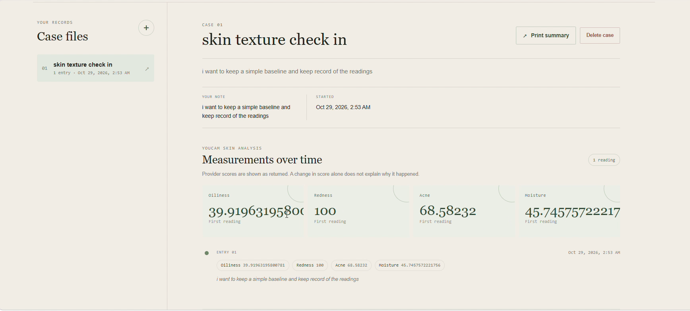
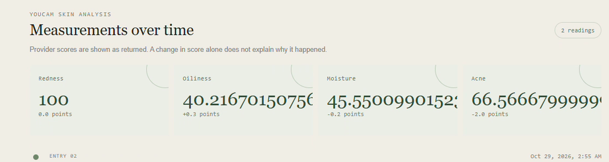

# Skin Casefile

**A private, dated record for a skin concern, combining real YouCam Skin Analysis readings with the notes and routine context that help a person remember what changed.**

Skin changes happen between purchases, routines, and appointments. People can lose track of when a concern appeared, what else changed, or how an earlier observation compared. Skin Casefile gives people one place to record that history and bring a clearer account to a professional conversation.

Skin Casefile is not a diagnostic tool or treatment recommender. Measurements do not establish a cause or prove that a product worked.

## Try the project

- Live web app: [skin-casefile.onrender.com](https://skin-casefile.onrender.com/)
- Landing page: `/`
- Casebook: `/dashboard`
- Public demo video: [YouTube](https://youtu.be/CITNpW-76z8) (62 seconds; link supplied by the project owner, not independently fetched by this environment)
- Repository: https://github.com/demonchant/skin-casefile

The app currently stores notes and returned measurements in browser local storage on that device. There is no account sync, cloud backup, or cross-device recovery.

## What it does

- Create a named record for a concern and add optional notes about timing, sensation, and routine or product changes.
- With explicit consent, send a selected selfie through the server to YouCam for a skin analysis.
- View returned readings alongside dated notes and follow-up check-ins; score differences are shown as arithmetic comparisons only.
- Print a portable summary for a discussion with a qualified professional.
- Show honest empty and error states; failed analysis does not create a record or pretend to have succeeded.

## Screenshots

These are genuine frames from the recorded browser demo. The result and timeline captures show the raw score values from that recording; the current interface prefers YouCam's user-facing score and labels the 1–100 scale.

| Landing page | Casebook dashboard |
| --- | --- |
|  |  |

| YouCam Skin Analysis result | Measurements over time |
| --- | --- |
|  |  |

## YouCam integration

The Node server authenticates with `YOUCAM_API_KEY` and calls the YouCam File API and asynchronous Skin Analysis API. After consent, the browser sends the selected image to the app server; the server obtains an upload URL, uploads the image to the signed destination, creates an analysis task, polls for completion, validates the provider response, and returns the readings. The app does not retain the photo. Provider image retention is governed by YouCam's terms and policy.

The API key remains server-side. The separate API secret is not used by this implementation. A scan consumes API units when successful. Live provider availability and results depend on a valid YouCam account and API key.

### How to read a score

Each feature score summarizes YouCam's photo analysis of acne presence, redness, hydration, or oiliness. Values use YouCam's 1–100 scale, not percentages. Skin Casefile displays YouCam's integer `ui_score` when available. YouCam describes that as a user-facing value adjusted from its raw analysis for consumer presentation; its documentation says higher values are more favorable within its model. If an older or partial result has no `ui_score`, Skin Casefile shows the raw score rounded to one decimal and labels it. These image based scores are not clinical severity ratings or diagnoses. Lighting, angle, and distance can affect a reading; a difference between readings alone does not explain cause or prove a routine had an effect. Comparisons are withheld if the two entries use different score fields. See [YouCam's score definitions](https://docs.perfectcorp.com/reference/ai_skin_analysis/v2.1).

## Run locally

Requirements: Node.js 22.9 or later and a YouCam API key for live analysis.

1. Copy `.env.example` to `.env` and set `YOUCAM_API_KEY`. Never commit `.env` or paste credentials into screenshots, logs, or source.
2. Start the server with `npm start`.
3. Visit `http://localhost:3000` or `http://localhost:3000/dashboard`.
4. Run local checks with `npm test`.

A new browser shows a genuine empty casebook. The project has no mock API fallback. If the key or provider is unavailable, analysis cannot complete.

## Deploy

`render.yaml` configures the Render Node web service. The project owner provided the live app URL above. This environment could not independently verify the deployed site. The service expects `YOUCAM_API_KEY` as a Render secret and exposes `/api/status` as a health check. See [deployment notes](submission/deployment-notes.md).

## Privacy and limits

- Case notes and readings are stored in the browser's local storage. Anyone with access to the same unlocked browser profile may view them.
- The app does not retain a selected photo, but the image is sent to YouCam for analysis after consent; the app cannot control the provider's retention policy.
- The server uses a per-browser random, HttpOnly session cookie to associate an in-progress analysis. Google sign-in and cloud accounts are not implemented.
- Skin readings are observations, not medical advice, diagnosis, treatment, or causal evidence.
- API use, network access, hosting, and any generated public URL require external account configuration. They are not provisioned by environment variables alone.

## Hackathon submission materials

- [Project description](submission/project-description.md)
- [YouTube title and description](submission/youtube-copy.md)
- [Screenshots](screenshots/)
- [Demo MP4, script, captions, voice-over, and QA report](output/)
- [Official hackathon rules](https://youcam-api-skin-ai-ecommerce.devpost.com/rules)
- The rules request a public 1–3 minute video showing the product on its target device and explaining the YouCam API. The supplied link has not been independently verified in this environment. Submission to Devpost and its receipt remain the entrant's responsibility.

## License

This project is licensed under the [MIT License](LICENSE). The license applies to this repository's original code and does not grant rights to YouCam services or third-party materials.
